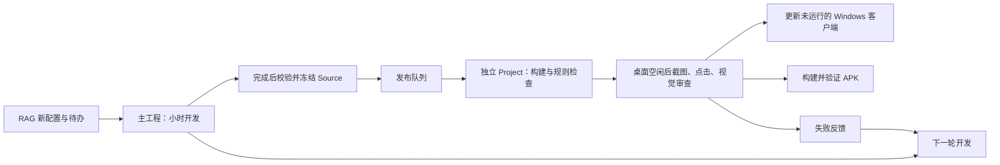

> 当前状态（2026-10-29）：用户已要求停止全部项目 agent。自动开发与发布已关闭；本文的周期、下一轮和启动命令仅说明历史机制，不能自行执行。以 [交接记录](Project-Status.md) 为准。

# S1 幽州持续开发与独立发布

用户授权每小时读取新 RAG 配置，持续改善 S1 幽州 40×40 的资源、玩法和 UI；2026-10-26 进一步要求发布与下一轮开发并行。Windows 与 APK 仍须通过完整验证才交付。当前待办见 [Hourly-UI-Gameplay-Backlog.md](Hourly-UI-Gameplay-Backlog.md)。

## 两条独立任务

- `EasternDynasty-S1-ContinuousDevelopment`：每五分钟检查是否到达小时开发时间，在主工程读取 RAG、完成一个改进、执行纯逻辑检查，然后冻结源码并入队。正常工作预算35分钟、进程上限40分钟，不等待发布。
- `EasternDynasty-S1-Publication`：每五分钟检查发布队列，在 `F:\EasternDynastyBuild\Releases\<版本>\Project` 的私有副本构建并验收。先做无桌面构建与规则检查；只有截图、真实点击和安装阶段需要等待桌面或客户端状态。

每条任务分别使用 Windows 命名互斥量、PID 锁、状态和日志。同一条任务不会重叠，开发与发布可同时运行。开发仅编辑主工程，禁止启动 Unity、客户端或桌面检查；所有 Unity 操作由发布者串行执行。后台任务需要电脑开机、用户登录，以及本机 Codex 登录、网络和 Unity 许可证有效；关机、休眠时不执行。



活动发布版本始终固定；新开发版本不会替换它的代码。尚未开始的多个候选合并为最新候选，避免逐个发布过时版本。冻结前后核验完整文件集合与 SHA，普通复制保留 meta；不使用与主工程共享写入的链接。`Source` 保存冻结输入，`Project` 允许 Unity 产生正常导入文件，最终验证另绑定实际构建源码集合。

## 每轮与发布门禁

1. `rag-sync.mjs` 读取版本、素材身份和配置摘要，产生 brief/delta/snapshot；读取不等于应用。开发代理按需查看原图、原文和既有游戏截图，记录应用与缺口，不把“无新 RAG”作为停止改进的理由。
2. 开发先读独立发布失败反馈，再处理 Backlog，更新 Iteration-Review 和验证入口。所有开发子代理完成后才冻结本轮。源码未完成或验证失败不得标为可交付。
3. 发布先执行准备、规则、资源、Windows 构建及 Unity 实盘仓库检查；检查点绑定源码、发布工具和构建清单，完全匹配才复用。
4. 桌面空闲后执行路线、双分辨率截图、手机安全区预览、真实鼠标与体验回归，再由只读 AI 查看至少四张本轮 PNG（包含手机图）。等待桌面不阻塞开发，不终止用户游戏、不改写真实存档。
5. 验证与视觉审查通过才安装到 `F:\工作项目\率土之滨\games`；同一候选构建 APK 到同级 `apk`，验证签名、清单、ARM 架构及源文件一致性。手机预览和包体检查不等于真机测试。微信发送已取消。

失败不会覆盖可玩版。发布反馈放在 `.local/publication/last-failure.json`，下一轮开发读取它；等待桌面和失败有独立状态，不写开发状态。发布记录按版本同步到主工程 `Validation/Releases`，实际截图、构建日志保留在快照工作副本。

## 入口与暂停

```powershell
# 查看两个任务
Get-ScheduledTask -TaskName 'EasternDynasty-S1-ContinuousDevelopment','EasternDynasty-S1-Publication'
Get-Content .local/continuous-development/status.json -Encoding UTF8
Get-Content .local/publication/status.json -Encoding UTF8
node Automation/runner.mjs --dry-run
node Automation/publisher.mjs --dry-run
# 检查自动化，再注册或更新两条任务
& .\Tools\Check-ContinuousDevelopment.ps1
& .\Tools\Start-ContinuousDevelopment.ps1
```

人工改源码前建立 `.local/continuous-development/manual-hold.json`，并等待已运行开发进程退出。它只暂停开发；发布有独立 `.local/publication/manual-hold.json`。两者均不强行中断当前进程。修改共享自动化工具前暂停对应任务并等待其退出。

开发状态：`reading_rag`、`optimizing`、`snapshotting`、`queued_for_publication`、`no_change`、`failed`。下次开发时间和最近排队版本在 `.local/continuous-development/state.json`。发布状态、当前固定版本与失败见 `.local/publication`；发布等待期间开发仍可继续。

Windows 实际交付以 `games/version.json` 为准，Android 以 `apk/build-info.json` 为准。任务运行、源码完成或测试通过均不等于新版本已经交付。队列及隔离细节见 [Parallel-Publication.md](Parallel-Publication.md)。