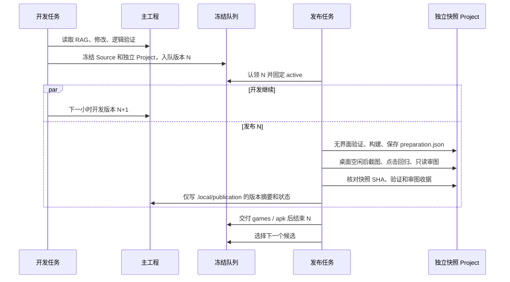

> 当前状态（2026-10-29）：用户已要求停止全部项目 agent。自动开发与发布已关闭；本文的周期、下一轮和启动命令仅说明历史机制，不能自行执行。以 [交接记录](Project-Status.md) 为准。

# 并行开发与发布

开发和发布是两个独立的 Windows 任务。开发每小时读取 RAG、改进主工程并运行纯逻辑检查，把完成的候选冻结入队后结束。发布任务负责 Unity、构建、真实截图、真实鼠标操作、只读视觉审查和最终交付。正在等待桌面空闲的版本不会阻止下一轮开发。



## 目录与所有权

- 主工程 `Assets`、`Packages`、`ProjectSettings` 由开发任务修改；发布器不写入这些目录，也不往主工程的 `Tools` 或 `Builds` 写构建产物。
- `.local/publication/queue` 保存冻结任务，`job-status` 保存发布进度，`active.json` 固定正在处理的版本。发布器持有独立命名互斥锁，进程信息在 `.local/publication/lock.json`。开发锁与发布锁互不阻塞。
- 快照的 `Source` 是不可修改的原始输入；`Project` 是 Unity 独立工作副本。所有构建、测试、截图及视觉审查收据保存在该快照下。Unity 首次生成 `.meta` 等合法行为由快照策略管理，完整验证后按 Project 自身的 `sourceFiles` 和 SHA 绑定批准。
- `.local/publication/status.json` 和 `last-failure.json` 给下一轮开发提供失败反馈；`history/<version>.json` 链接该版本的交付与验证证据。另同步主工程 `Validation/Releases/<version>/publication.json` 摘要，包括等待与失败状态，原来的 `release.json` 保留不覆盖。发布器不修改开发的 `state.json`。
- Windows 目标目录显式指定为主工程同级的 `games`；Android 为同级 `apk`，不会误装到快照目录旁。

## 发布门禁与重试

`Publish-Iteration.ps1 -ValidateOnly -DestinationPath ...` 先执行不需要桌面的检查与构建，并保存可复用的准备检查点。桌面忙碌或玩家运行时返回等待状态，保持当前 active 版本。后续重试复用与源文件及构建清单完全匹配的准备结果。

完整发布仍须通过逻辑、资源、Unity 仓库、行军路线、桌面与手机布局、旧界面、真实鼠标点击及体验回归。只读 Codex 审查必须实际查看至少四张本版本截图（包括手机截图），返回明确通过结论。验证收据、审图收据和所看截图各自 SHA 与版本一起保存，安装和 Android 构建前再次核对；主工程后来新增的改动不会让已冻结版本失效。

Windows 安装发现玩家正在运行时保留版本，已批准的 Android 构建可以继续。Android 必须通过包身份、签名、源码快照和实际 APK SHA 校验；这些检查不代表已经完成真机测试。Android 暂时失败可等待十五分钟重试一次，复用已通过的视觉审批和 Windows 安装状态；再次失败将反馈给开发并让队列处理后续修复候选。源码或视觉证据失效直接失败，不能复用审批。

## 运行与排查

```powershell
# 只读查看队列、active 与交付目录；不认领版本、构建或交付。
.\Tools\Tick-Publication.ps1 -DryRun

# 执行一次发布 tick；常规运行由独立 Windows 任务调用。
.\Tools\Tick-Publication.ps1

# 隔离 fixture 测试，不启动 Unity、桌面或真实发布。
node .\Validation\PublisherChecks.mjs
```

`Automation/config.json` 的 `publicationEnabled` 控制发布任务，缺省沿用 `enabled`。发布暂停文件为 `.local/publication/manual-hold.json`，开发暂停文件保持独立；`releaseTimeoutMinutes` 和 `androidTimeoutMinutes` 分别约束子进程。既有 `.local/continuous-development/paths.json` 仅提供 Node、PowerShell 和 Codex CLI 路径，不包含新凭据。

`--dry-run` 只读诊断，读取时可短暂持有队列的命名互斥锁，但不创建诊断目录或改动队列文件。测试通过显式依赖注入提供临时队列、虚拟进程及租约，并单独检查真实队列的只读诊断入口；命令行入口始终使用实际发布门禁，不存在环境变量或测试开关绕过审批。
